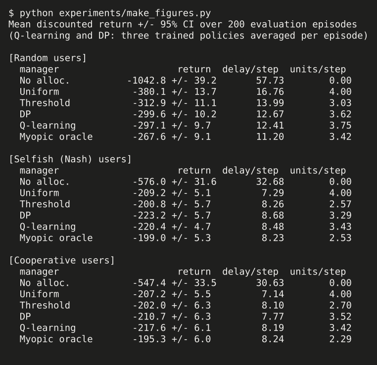
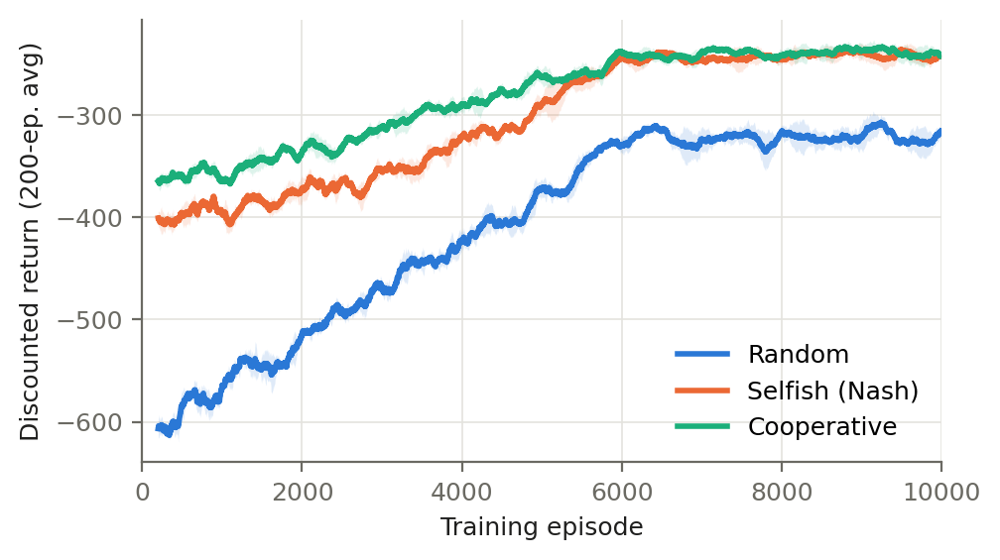
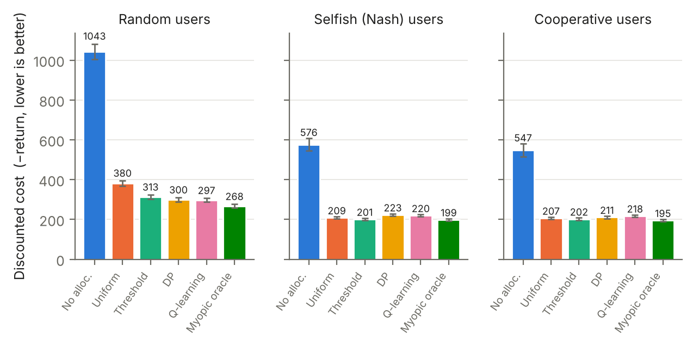
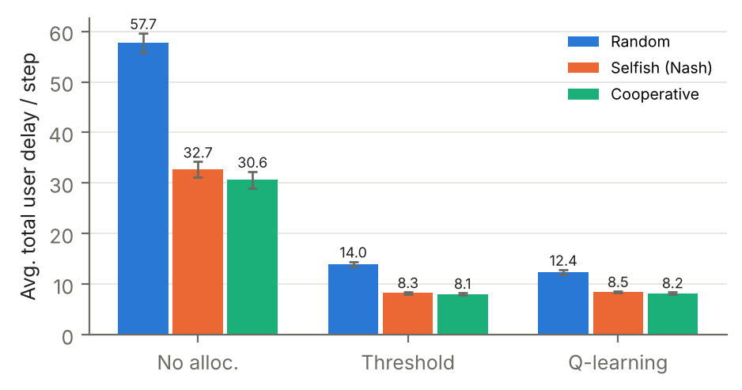
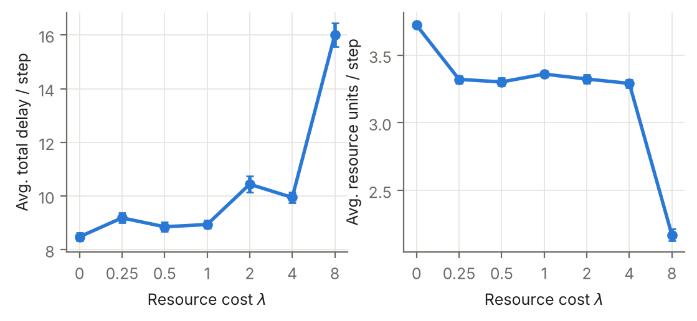
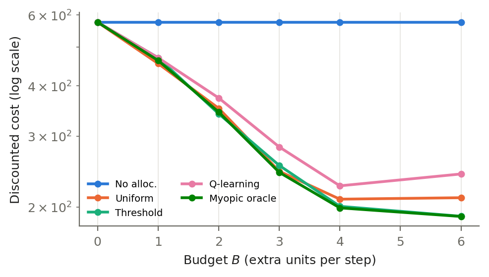
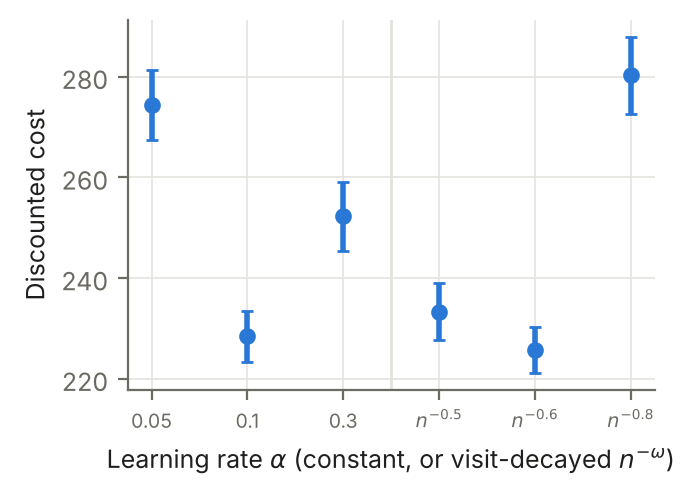
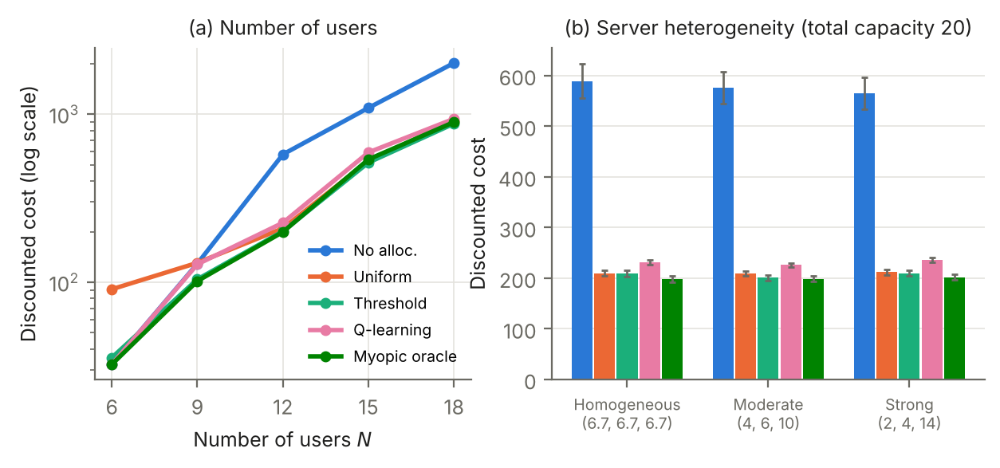

# Multi-Agent Compute Scheduling under Congestion

**Team:** Kshitij Srivastava · Kushal Kumar · Vishawraj Meena · Tejas Prasad

*N* users send jobs to *K* heterogeneous servers. A resource manager has a budget of *B* extra
capacity units per step and must decide where to put them to cut user delay without wasting
resources. We model the manager's problem as an MDP, simulate three kinds of user behaviour
(random, selfish/Nash, cooperative), and compare a **Q-learning** manager and a
**dynamic-programming (value-iteration)** manager with heuristic baselines and an oracle.

The final report is in [`report/report.pdf`](report/report.pdf).

## MDP in one table

| Component | Definition |
|---|---|
| State | `x ∈ {0,1,2}^K`: each server's load `W_j / C_j` discretised with thresholds τ1 = 0.75, τ2 = 1.25 (27 states) |
| Action | `d ∈ Z^K_{≥0}`, `Σ d_j ≤ B`: extra units per server (35 actions for K = 3, B = 4) |
| Reward | `−Σ_i (W_{a_i} / (C_{a_i} + η d_{a_i}))^κ − λ Σ_j d_j` |
| Transition | Unserved work carries over as backlog, workloads follow a hidden low/high demand regime, users re-pick servers after seeing the previous allocation |
| Termination | Fixed horizon of T = 50 steps, γ = 0.95 |

## Repository layout

```
src/
  env.py          congestion environment (state, action space, reward, transitions)
  scheduling.py   user behaviour: random, selfish (best-response → Nash), cooperative (heuristic social-cost planner)
  agents.py       Q-learning, certainty-equivalent DP, baselines, evaluation
experiments/
  run_all.py      runs the main experiments → results/results.json
                  (--extra: number-of-users and heterogeneity sweeps → results/results_extra.json)
  make_figures.py builds all figures + LaTeX tables from the results files
results/
  results.json    raw numbers used in the report (main experiments)
  results_extra.json  raw numbers for the number-of-users and heterogeneity sweeps
  summary.txt     main comparison table (plain text)
  table_*.tex     tables included in the report
  figures/        all plots (PDF + PNG)
report/           LaTeX source + compiled PDF
screenshots/      screenshots of the results
```

## How to reproduce

```bash
pip install -r requirements.txt
python experiments/run_all.py          # main experiments (~30 min on 2 cores, uses all CPU cores)
python experiments/run_all.py --extra  # number-of-users and heterogeneity sweeps (~5 min)
python experiments/make_figures.py     # all figures, tables and the summary
cd report && pdflatex report.tex && pdflatex report.tex   # rebuild the report (two passes)
```

Adding `--quick` to either `run_all.py` command does a fast smoke test (under a minute); it
writes to a temporary folder, so the committed results are never overwritten. All runs use
fixed seeds: training uses seeds 0, 1, 2, and every manager is evaluated on the same 200
held-out episode seeds (with selfish users, workloads diverge once managers act differently).
Q-learning and DP results average the three trained policies per episode, so all 95%
confidence intervals are over 200 episodes.

## Default parameters

N = 12 users, K = 3 servers with C = (4, 6, 10), η = 2, B = 4, κ = 2, λ = 1,
mean job size 1.2 (low regime) / 2.2 (high regime), regime-switch probability 0.1,
T = 50, γ = 0.95. Q-learning: 10,000 episodes, ε decays linearly from 1 to 0.05 over the
first 60% of episodes, learning rate α = max(0.01, n(s,a)^−0.6). DP: model estimated from
1,500 episodes of random allocations, then value iteration.

## Results



| Learning curves | Manager comparison |
|---|---|
|  |  |

| User behaviour (price of anarchy) | Effect of the resource cost λ |
|---|---|
|  |  |

| Effect of the budget B | Learning-rate sensitivity |
|---|---|
|  |  |

| Number of users and server heterogeneity |
|---|
|  |

Greedy actions of the learned policies are in [`results/table_policy.tex`](results/table_policy.tex).
See Section 5 of the report for the discussion.
